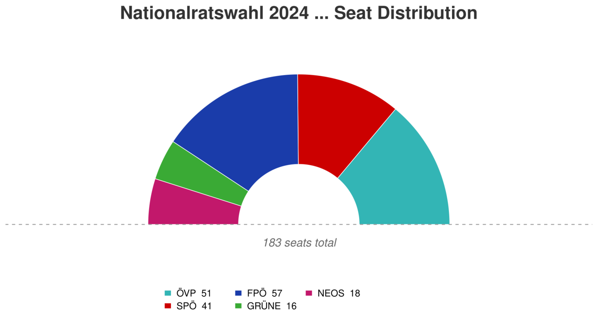
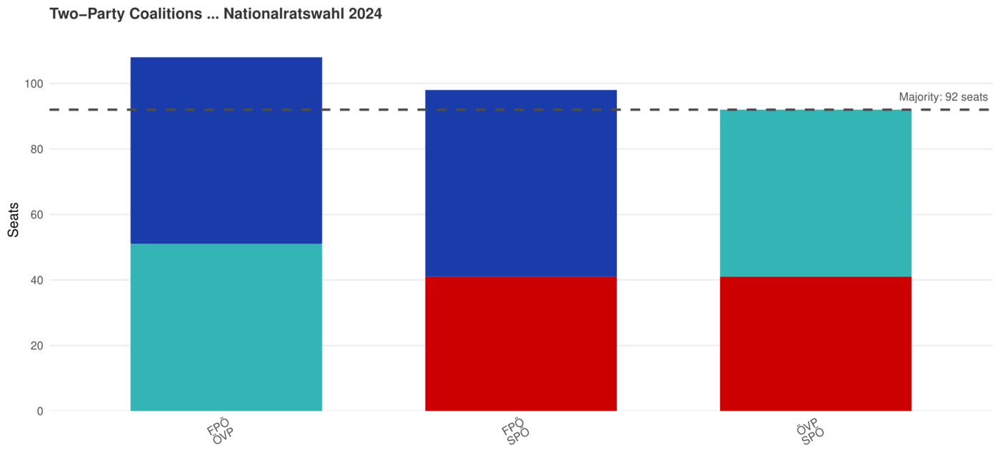
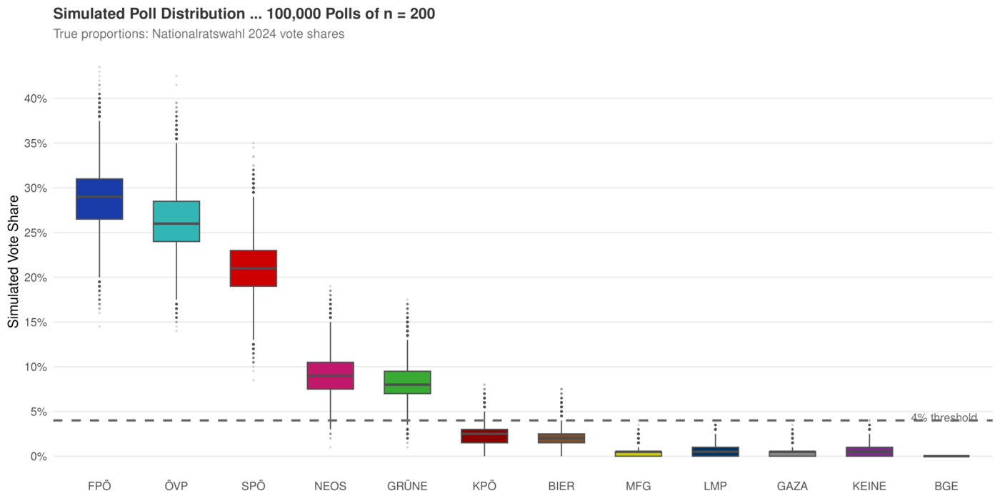

```{=html}
<nav class="fp-nav">
  <div class="fp-nav-inner">
    <a href="index.html" class="fp-nav-logo">Filip <span>Popovic</span></a>
    <ul class="fp-nav-links">
      <li><a href="index.html">Home</a></li>
      <li><a href="projects.html" class="active">Projects</a></li>
      <li><a href="about.html">About</a></li>
      <li><a href="contact.html">Contact</a></li>
    </ul>
    <button class="fp-theme-btn" data-theme-toggle aria-label="Toggle dark mode">
      <svg width="18" height="18" viewBox="0 0 24 24" fill="none" stroke="currentColor" stroke-width="2"><path d="M21 12.79A9 9 0 1 1 11.21 3 7 7 0 0 0 21 12.79z"/></svg>
    </button>
  </div>
</nav>

<section class="fp-detail-hero">
  <div class="fp-container">
    <a href="projects.html" class="fp-back-link"><svg width="14" height="14" viewBox="0 0 24 24" fill="none" stroke="currentColor" stroke-width="2.5"><path d="M19 12H5M12 19l-7-7 7-7"/></svg> All projects</a>
    <span class="fp-project-tag">Data Pipeline · Political Science</span>
    <h1>Austrian Elections: From Ballots to Coalitions</h1>
    <p class="fp-detail-lead">A complete analysis pipeline for the Austrian parliamentary elections 2019 and 2024: from raw official result files to validated data, seat allocation, coalition maths and a simulation of polling uncertainty. Built entirely in R.</p>
    <div class="fp-kpis">
      <div class="fp-kpi"><div class="fp-kpi-number">183</div><div class="fp-kpi-label">Seats allocated (D'Hondt)</div></div>
      <div class="fp-kpi"><div class="fp-kpi-number">3</div><div class="fp-kpi-label">Elections processed</div></div>
      <div class="fp-kpi"><div class="fp-kpi-number">5</div><div class="fp-kpi-label">Automated consistency checks</div></div>
      <div class="fp-kpi"><div class="fp-kpi-number">100,000</div><div class="fp-kpi-label">Simulated polls</div></div>
    </div>
  </div>
</section>

<section class="fp-section" style="padding-top:0;">
  <div class="fp-detail-body">
    <h2>The question</h2>
    <p>In 2024 the FPÖ won the most votes of any party in either election, the first time a far-right party finished
    first in a national election in post-war Austria. Yet it did not end up in government. This project shows why:
    in a proportional system, <strong>coalition mathematics matter as much as raw vote shares</strong>.</p>

    <h2>Data pipeline</h2>
    <ul>
      <li><strong>Source:</strong> official results of the Federal Ministry of the Interior at municipality, district, state and national level</li>
      <li><strong>Elections:</strong> Nationalratswahl 2019 and 2024, plus the presidential election 2022 as a test case for the validation</li>
      <li><strong>Automated ingestion:</strong> the pipeline detects all result files, harmonises column names and data types, and adapts automatically to new elections, so adding one only requires dropping in the file</li>
      <li><strong>Validation:</strong> five consistency checks, for example that votes add up across geographic levels and that valid plus invalid votes match ballots cast</li>
    </ul>

    <h2>Seat allocation</h2>
    <p>Seats were allocated with my own implementation of the <strong>D'Hondt method</strong>, written in
    vectorised R without electoral packages.</p>
    <figure class="fp-figure">
      
      <figcaption>Seat distribution after the 2024 election: FPÖ 57, ÖVP 51, SPÖ 41, NEOS 18, Greens 16.</figcaption>
    </figure>

    <h2>Coalition modelling</h2>
    <p>A government needs at least 92 of 183 seats. An exhaustive search over all party combinations shows which
    coalitions are mathematically possible. In 2024, every two-party majority required the ÖVP or the SPÖ. In the
    end a three-party coalition of ÖVP, SPÖ and NEOS was formed without the FPÖ.</p>
    <figure class="fp-figure">
      
      <figcaption>All two-party combinations with a majority in 2024. ÖVP-SPÖ only just reaches the 92-seat threshold.</figcaption>
    </figure>

    <h2>How reliable are polls?</h2>
    <p>Using the 2024 result as the "true" vote shares, I simulated 100,000 polls with 200 respondents each. Even
    when the true shares are known exactly, realistic sample sizes produce a wide spread of outcomes, especially for
    smaller parties near the 4% threshold for entering parliament.</p>
    <figure class="fp-figure">
      
      <figcaption>Distribution of 100,000 simulated polls (n = 200). The dashed line marks the 4% threshold.</figcaption>
    </figure>

    <h2>Key takeaways</h2>
    <ul>
      <li>Winning the most votes does not mean winning the most governing power.</li>
      <li>Polls should be read as distributions, not point predictions.</li>
      <li>A generalised, validated pipeline turns a one-off analysis into reusable infrastructure.</li>
    </ul>

    <h2>Tools</h2>
    <p>R (xlsx, ggplot2, kableExtra), RMarkdown.</p>
  </div>
</section>

<section class="fp-section fp-pdf-section" style="padding-top:0;">
  <div class="fp-container">
    <div class="fp-pdf-head">
      <h2>Full report</h2>
      <a href="pdfs/elections-report.pdf" target="_blank" class="btn btn-outline">Open PDF in new tab</a>
    </div>
    <iframe class="fp-pdf-frame" src="pdfs/elections-report.pdf#view=FitH" title="Full report: Austrian Elections: From Ballots to Coalitions"></iframe>
  </div>
</section>

<section class="fp-section fp-section-alt">
  <div class="fp-container">
    <div class="fp-contact-box">
      <h2>Interested in my work?</h2>
      <p>I'm currently looking for an entry-level role in data analysis, data science or risk analytics.</p>
      <div class="fp-contact-links">
        <a href="contact.html" class="btn btn-primary">Get in touch</a>
        <a href="projects.html" class="btn btn-outline">All projects</a>
      </div>
    </div>
  </div>
</section>

<footer class="fp-footer">
  <p>© 2026 Filip Popovic · Vienna, Austria</p>
</footer>

<script>
(function(){
  const t = document.querySelector('[data-theme-toggle]');
  const r = document.documentElement;
  let d = matchMedia('(prefers-color-scheme:dark)').matches ? 'dark' : 'light';
  r.setAttribute('data-theme', d);
  if(t) t.addEventListener('click', () => { d = d === 'dark' ? 'light' : 'dark'; r.setAttribute('data-theme', d); });
})();
</script>
```
