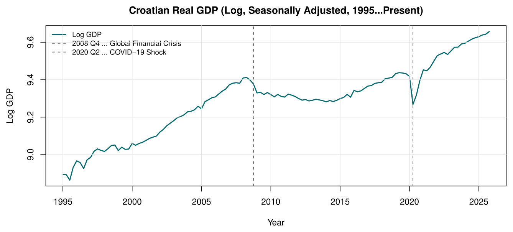
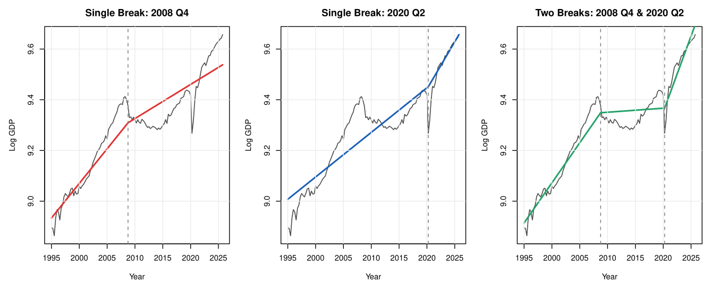
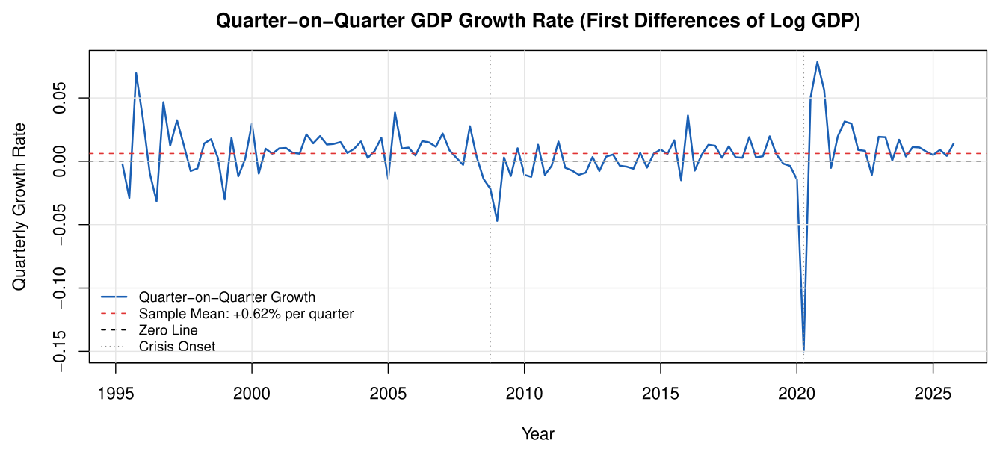

```{=html}
<nav class="fp-nav">
  <div class="fp-nav-inner">
    <a href="index.html" class="fp-nav-logo">Filip <span>Popovic</span></a>
    <ul class="fp-nav-links">
      <li><a href="index.html">Home</a></li>
      <li><a href="projects.html" class="active">Projects</a></li>
      <li><a href="about.html">About</a></li>
      <li><a href="contact.html">Contact</a></li>
    </ul>
    <button class="fp-theme-btn" data-theme-toggle aria-label="Toggle dark mode">
      <svg width="18" height="18" viewBox="0 0 24 24" fill="none" stroke="currentColor" stroke-width="2"><path d="M21 12.79A9 9 0 1 1 11.21 3 7 7 0 0 0 21 12.79z"/></svg>
    </button>
  </div>
</nav>

<section class="fp-detail-hero">
  <div class="fp-container">
    <a href="projects.html" class="fp-back-link"><svg width="14" height="14" viewBox="0 0 24 24" fill="none" stroke="currentColor" stroke-width="2.5"><path d="M19 12H5M12 19l-7-7 7-7"/></svg> All projects</a>
    <span class="fp-project-tag">Time Series · Economics</span>
    <h1>Croatian Real GDP: Trends, Cycles and Persistence</h1>
    <p class="fp-detail-lead">How did the 2008 financial crisis and the COVID-19 shock shape Croatia's growth path? Is GDP growth random noise, or does it have structure? Trend models, the HP filter, spectral analysis and ARFIMA models on quarterly data since 1995.</p>
    <div class="fp-kpis">
      <div class="fp-kpi"><div class="fp-kpi-number">1995+</div><div class="fp-kpi-label">Quarterly data (FRED)</div></div>
      <div class="fp-kpi"><div class="fp-kpi-number">4</div><div class="fp-kpi-label">Methods combined</div></div>
      <div class="fp-kpi"><div class="fp-kpi-number">+0.62%</div><div class="fp-kpi-label">Mean growth per quarter</div></div>
      <div class="fp-kpi"><div class="fp-kpi-number">126</div><div class="fp-kpi-label">Quarters of data</div></div>
    </div>
  </div>
</section>

<section class="fp-section" style="padding-top:0;">
  <div class="fp-detail-body">
    <h2>The question</h2>
    <p>Croatia's economy has grown steadily since the mid-1990s, but not smoothly. The analysis looks at three
    practical questions: what the long-run growth path looks like and how crises changed it, whether there is
    predictable structure in GDP growth, and how persistent economic shocks are.</p>
    <figure class="fp-figure">
      
      <figcaption>Croatian real GDP (log, seasonally adjusted). The dashed lines mark the Global Financial Crisis (2008 Q4) and the COVID-19 shock (2020 Q2).</figcaption>
    </figure>

    <h2>Trend analysis</h2>
    <p>I compared polynomial trends of degree 1 to 4, broken linear trends with structural breaks and the
    Hodrick-Prescott filter at several smoothing levels. The broken trend model with breaks in 2008 Q4 and 2020 Q2
    separates three distinct phases: the pre-crisis boom, a decade of stagnation and the post-COVID acceleration.</p>
    <figure class="fp-figure">
      
      <figcaption>Broken linear trends with one and two structural breaks. The two-break model (right) fits the three growth phases best.</figcaption>
    </figure>
    <figure class="fp-figure">
      
      <figcaption>Quarter-on-quarter growth rates. 2020 Q2 is the steepest fall in the sample, immediately followed by the strongest recovery.</figcaption>
    </figure>

    <h2>Key takeaways</h2>
    <ul>
      <li>The 2008 crisis did lasting damage. Growth stayed weak for almost a decade.</li>
      <li>COVID-19 caused the sharpest drop, but the recovery was fast, driven by tourism and external demand.</li>
          </ul>

    <h2>Tools</h2>
    <p>R (mFilter, fracdiff, kableExtra), RMarkdown.</p>
  </div>
</section>

<section class="fp-section fp-pdf-section" style="padding-top:0;">
  <div class="fp-container">
    <div class="fp-pdf-head">
      <h2>Full report</h2>
      <a href="pdfs/gdp-report.pdf" target="_blank" class="btn btn-outline">Open PDF in new tab</a>
    </div>
    <iframe class="fp-pdf-frame" src="pdfs/gdp-report.pdf#view=FitH" title="Full report: Croatian Real GDP: Trends, Cycles and Persistence"></iframe>
  </div>
</section>

<section class="fp-section fp-section-alt">
  <div class="fp-container">
    <div class="fp-contact-box">
      <h2>Interested in my work?</h2>
      <p>I'm currently looking for an entry-level role in data analysis, data science or risk analytics.</p>
      <div class="fp-contact-links">
        <a href="contact.html" class="btn btn-primary">Get in touch</a>
        <a href="projects.html" class="btn btn-outline">All projects</a>
      </div>
    </div>
  </div>
</section>

<footer class="fp-footer">
  <p>© 2026 Filip Popovic · Vienna, Austria</p>
</footer>

<script>
(function(){
  const t = document.querySelector('[data-theme-toggle]');
  const r = document.documentElement;
  let d = matchMedia('(prefers-color-scheme:dark)').matches ? 'dark' : 'light';
  r.setAttribute('data-theme', d);
  if(t) t.addEventListener('click', () => { d = d === 'dark' ? 'light' : 'dark'; r.setAttribute('data-theme', d); });
})();
</script>
```
