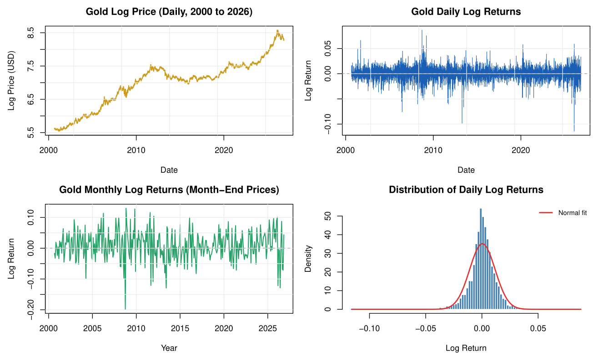
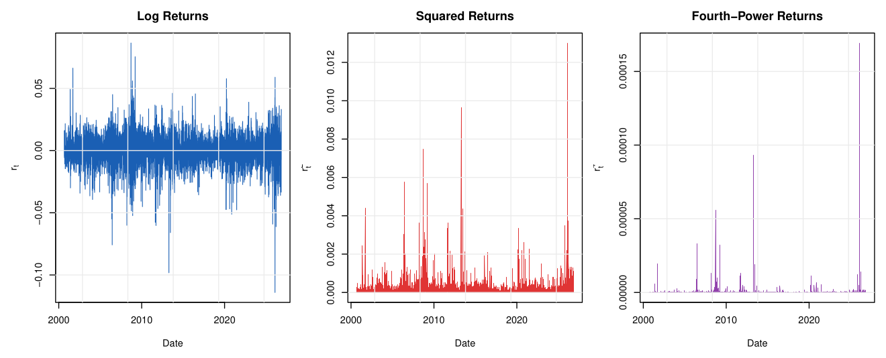
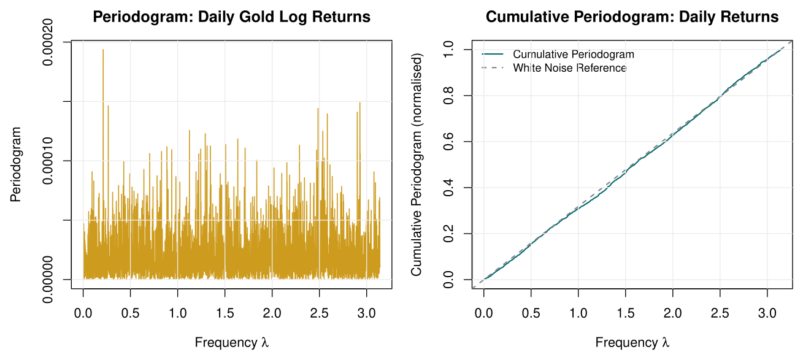

```{=html}
<nav class="fp-nav">
  <div class="fp-nav-inner">
    <a href="index.html" class="fp-nav-logo">Filip <span>Popovic</span></a>
    <ul class="fp-nav-links">
      <li><a href="index.html">Home</a></li>
      <li><a href="projects.html" class="active">Projects</a></li>
      <li><a href="about.html">About</a></li>
      <li><a href="contact.html">Contact</a></li>
    </ul>
    <button class="fp-theme-btn" data-theme-toggle aria-label="Toggle dark mode">
      <svg width="18" height="18" viewBox="0 0 24 24" fill="none" stroke="currentColor" stroke-width="2"><path d="M21 12.79A9 9 0 1 1 11.21 3 7 7 0 0 0 21 12.79z"/></svg>
    </button>
  </div>
</nav>

<section class="fp-detail-hero">
  <div class="fp-container">
    <a href="projects.html" class="fp-back-link"><svg width="14" height="14" viewBox="0 0 24 24" fill="none" stroke="currentColor" stroke-width="2.5"><path d="M19 12H5M12 19l-7-7 7-7"/></svg> All projects</a>
    <span class="fp-project-tag">Time Series · Finance</span>
    <h1>Gold Returns: Is There Anything to Predict?</h1>
    <p class="fp-detail-lead">Gold is called a safe haven, but are its price movements predictable? Spectral analysis and a long-memory model on 26 years of daily and monthly gold futures data test whether past returns contain any exploitable pattern.</p>
    <div class="fp-kpis">
      <div class="fp-kpi"><div class="fp-kpi-number">6,570</div><div class="fp-kpi-label">Trading days since 2000</div></div>
      <div class="fp-kpi"><div class="fp-kpi-number">p ≥ 0.37</div><div class="fp-kpi-label">Spectral white noise test</div></div>
      <div class="fp-kpi"><div class="fp-kpi-number">d = 0.02</div><div class="fp-kpi-label">Memory parameter, not significant</div></div>
      <div class="fp-kpi"><div class="fp-kpi-number">0</div><div class="fp-kpi-label">Seasonal patterns found</div></div>
    </div>
  </div>
</section>

<section class="fp-section" style="padding-top:0;">
  <div class="fp-detail-body">
    <h2>The question</h2>
    <p>If gold returns had a detectable pattern, past prices would help predict future ones. The analysis tests this
    formally at every frequency, from daily movements to seasonal effects across the year.</p>
    <figure class="fp-figure">
      
      <figcaption>Top: gold log price and daily log returns. Bottom: monthly returns and the distribution of daily returns. The heavy tails show that extreme moves happen more often than a normal distribution predicts.</figcaption>
    </figure>

    <h2>Volatility</h2>
    <p>While returns themselves hover around zero, their size is not random. Squared and fourth-power returns show
    clear <strong>volatility clustering</strong>: turbulent days come in groups. The most volatile years were 2008, 2026 and 2006, and the largest single move was a drop of 11.4% on 30 January 2026.</p>
    <figure class="fp-figure">
      
      <figcaption>Log returns, squared returns and fourth-power returns. Large swings cluster in time.</figcaption>
    </figure>

    <h2>Spectral analysis and long memory</h2>
    <p>The periodogram shows no dominant frequency, and the cumulative periodogram follows the white noise reference
    almost perfectly. The spectral white noise test from the lecture does not reject at any threshold (p-values from
    0.37 to 0.81), and a test at the six calendar frequencies of the monthly returns finds no seasonality.
    A semiparametric estimate of the memory parameter gives d = 0.019 with a standard error of 0.027,
    so there is no evidence of long memory.</p>
    <figure class="fp-figure">
      
      <figcaption>Periodogram (left) and cumulative periodogram (right) of daily gold returns. The close match with the white noise line means there is no linear pattern to exploit.</figcaption>
    </figure>

    <h2>Key takeaways</h2>
    <ul>
      <li>Past gold prices contain essentially no usable linear information about future prices, consistent with the weak-form efficient market hypothesis. A Ljung-Box test rejects narrowly (p = 0.03), most likely because volatility clusters, and any remaining effect is far too small to trade on.</li>
      <li>The direction of moves is unpredictable, but their size is not. That matters for risk management.</li>
      <li>Natural next step: volatility models such as GARCH.</li>
    </ul>

    <h2>Tools</h2>
    <p>R (quantmod, fracdiff, kableExtra), RMarkdown.</p>
  </div>
</section>

<section class="fp-section fp-pdf-section" style="padding-top:0;">
  <div class="fp-container">
    <div class="fp-pdf-head">
      <h2>Full report</h2>
      <a href="pdfs/gold-report.pdf" target="_blank" class="btn btn-outline">Open PDF in new tab</a>
    </div>
    <iframe class="fp-pdf-frame" src="pdfs/gold-report.pdf#view=FitH" title="Full report: Gold Returns: Is There Anything to Predict?"></iframe>
  </div>
</section>

<section class="fp-section fp-section-alt">
  <div class="fp-container">
    <div class="fp-contact-box">
      <h2>Interested in my work?</h2>
      <p>I'm currently looking for an entry-level role in data analysis, data science or risk analytics.</p>
      <div class="fp-contact-links">
        <a href="contact.html" class="btn btn-primary">Get in touch</a>
        <a href="projects.html" class="btn btn-outline">All projects</a>
      </div>
    </div>
  </div>
</section>

<footer class="fp-footer">
  <p>© 2026 Filip Popovic · Vienna, Austria</p>
</footer>

<script>
(function(){
  const t = document.querySelector('[data-theme-toggle]');
  const r = document.documentElement;
  let d = matchMedia('(prefers-color-scheme:dark)').matches ? 'dark' : 'light';
  r.setAttribute('data-theme', d);
  if(t) t.addEventListener('click', () => { d = d === 'dark' ? 'light' : 'dark'; r.setAttribute('data-theme', d); });
})();
</script>
```
