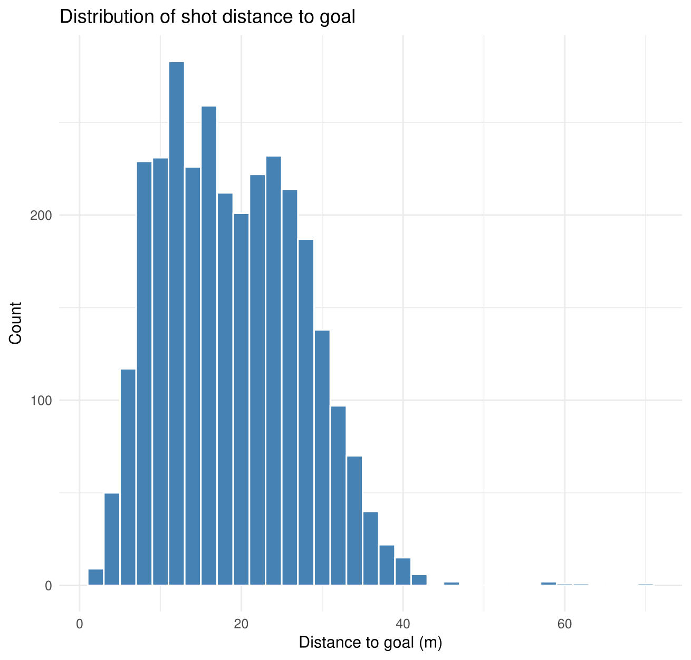
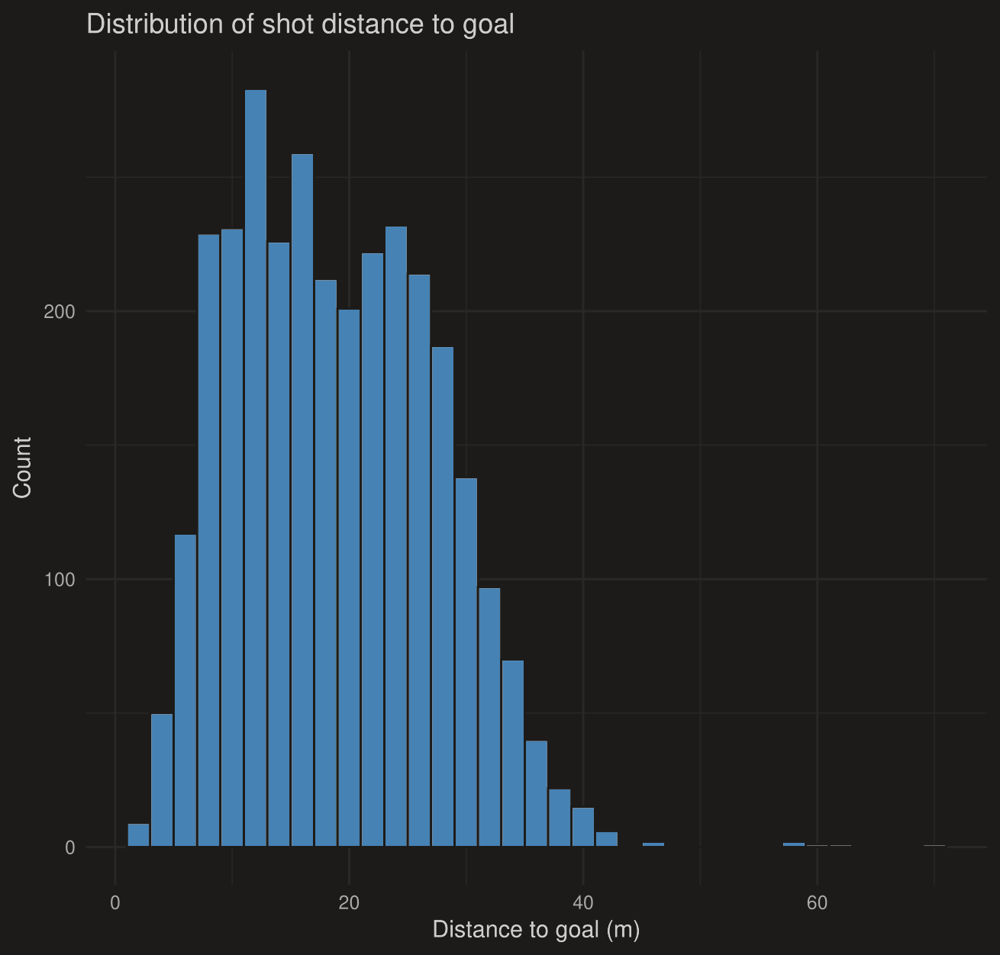
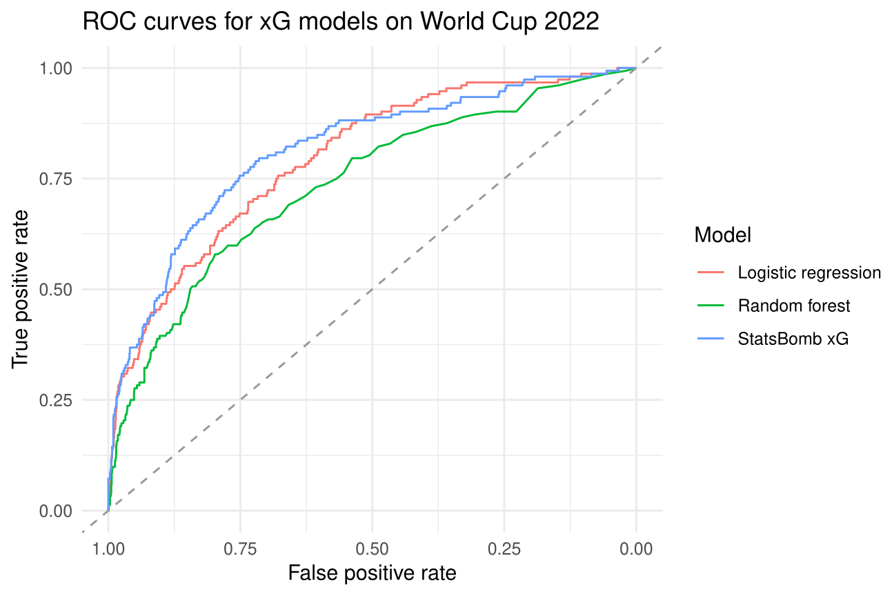
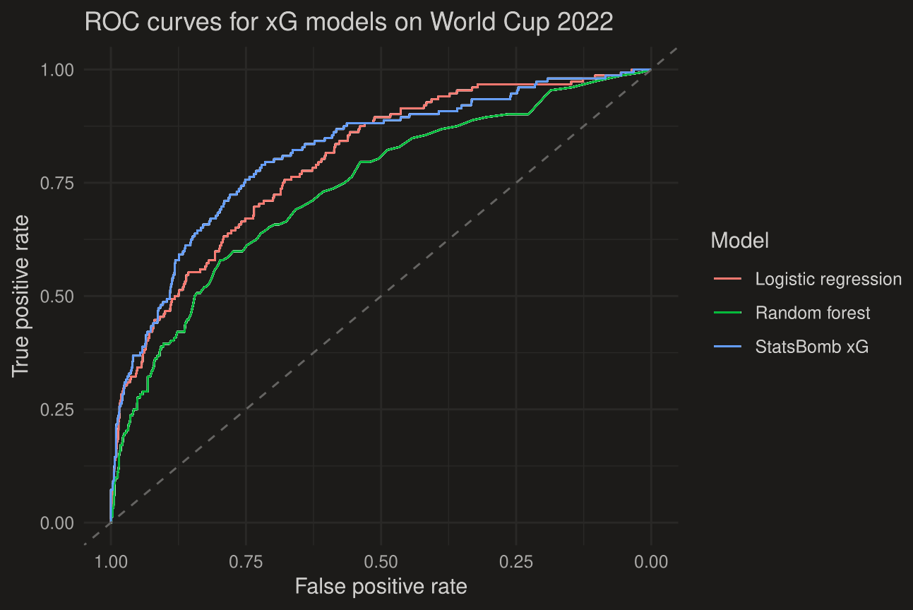
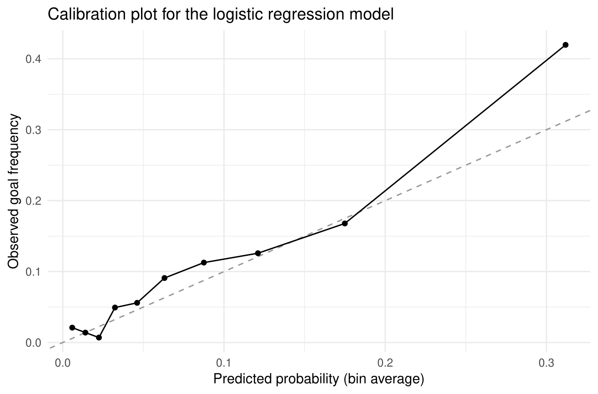
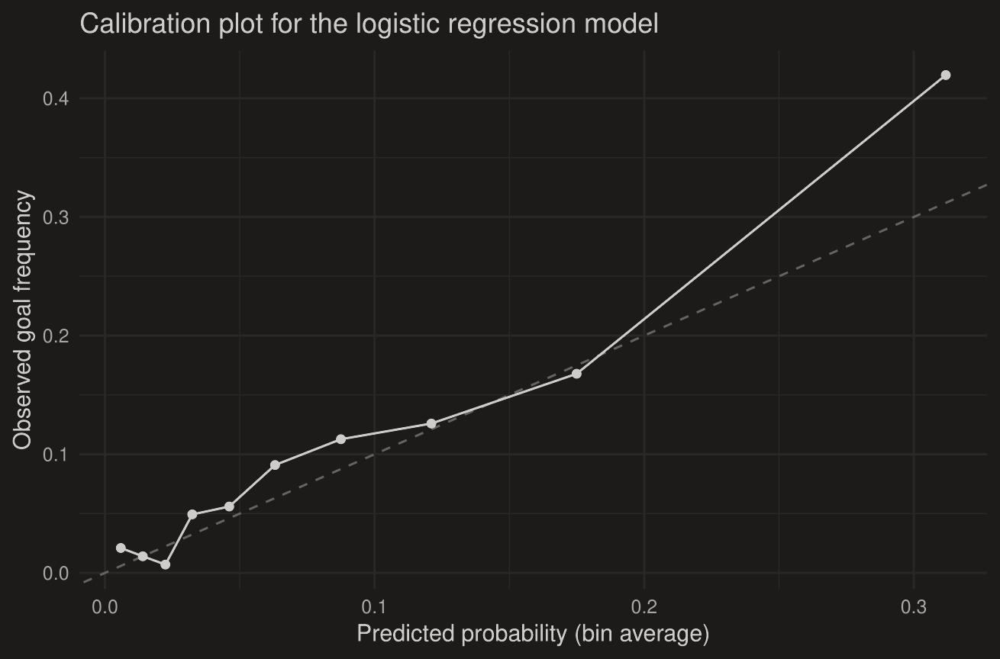

```{=html}
<nav class="fp-nav">
  <div class="fp-nav-inner">
    <a href="index.html" class="fp-nav-logo">Filip <span>Popovic</span></a>
    <ul class="fp-nav-links">
      <li><a href="index.html">Home</a></li>
      <li><a href="projects.html" class="active">Projects</a></li>
      <li><a href="about.html">About</a></li>
      <li><a href="contact.html">Contact</a></li>
    </ul>
    <button class="fp-theme-btn" data-theme-toggle aria-label="Toggle dark mode">
      <svg width="18" height="18" viewBox="0 0 24 24" fill="none" stroke="currentColor" stroke-width="2"><path d="M21 12.79A9 9 0 1 1 11.21 3 7 7 0 0 0 21 12.79z"/></svg>
    </button>
  </div>
</nav>

<section class="fp-detail-hero">
  <div class="fp-container">
    <a href="projects.html" class="fp-back-link"><svg width="14" height="14" viewBox="0 0 24 24" fill="none" stroke="currentColor" stroke-width="2.5"><path d="M19 12H5M12 19l-7-7 7-7"/></svg> All projects</a>
    <span class="fp-project-tag">Bachelor's Thesis · Sports Analytics · Graded 1 (excellent)</span>
    <h1>Estimating Expected Goals</h1>
    <p class="fp-detail-lead">Can a simple, interpretable logistic regression keep up with machine learning and an industry model when estimating the probability that a shot becomes a goal? Using every shot from the FIFA World Cups 2018 and 2022, this thesis shows that it can.</p>
    <div class="fp-kpis">
      <div class="fp-kpi"><div class="fp-kpi-number">3,067</div><div class="fp-kpi-label">Shots analysed</div></div>
      <div class="fp-kpi"><div class="fp-kpi-number">0.80</div><div class="fp-kpi-label">AUC · logistic regression</div></div>
      <div class="fp-kpi"><div class="fp-kpi-number">0.81</div><div class="fp-kpi-label">AUC · StatsBomb benchmark</div></div>
      <div class="fp-kpi"><div class="fp-kpi-number">0.73</div><div class="fp-kpi-label">AUC · random forest</div></div>
    </div>
  </div>
</section>

<section class="fp-section" style="padding-top:0;">
  <div class="fp-detail-body">
    <h2>The question</h2>
    <p>Expected goals (xG) is one of the central metrics in modern football analytics: it assigns every shot a
    probability of being scored, based on where and how it was taken. Commercial providers like StatsBomb build
    their xG models on large proprietary datasets. This thesis asks how close you can get with
    <strong>publicly available data and standard statistical methods</strong>, and whether a flexible machine
    learning model actually beats a classical one.</p>

    <h2>Data</h2>
    <ul>
      <li><strong>Source:</strong> StatsBomb Open Data, all shots from the FIFA World Cups 2018 and 2022</li>
      <li><strong>Sample:</strong> 3,067 shots after excluding penalties, of which 287 were goals (9.35%), a strongly imbalanced target</li>
      <li><strong>Features:</strong> 11 variables, including distance and angle to goal, the goalkeeper's position,
      defenders in the shooting cone, body part, technique, shot type, pressure, first-time shots and one-on-ones</li>
    </ul>
    <figure class="fp-figure">
      
      
      <figcaption>Distribution of shot distance to goal. Most shots are taken from roughly 5 to 35 metres, with a long tail of speculative long-range efforts.</figcaption>
    </figure>

    <h2>Approach</h2>
    <p>Instead of a random train/test split, the models were evaluated with <strong>temporal validation</strong>:
    trained on the 2018 World Cup and tested on the 2022 World Cup. This mirrors how a model would actually be used
    in practice, namely to predict a future tournament.</p>
    <ul>
      <li><strong>Logistic regression</strong> as an interpretable statistical baseline</li>
      <li><strong>Random forest</strong> as a flexible machine learning method, tuned via cross-validated log loss</li>
      <li><strong>StatsBomb xG</strong> as an external industry benchmark</li>
    </ul>
    <p>Performance was measured by discrimination (AUC), probabilistic accuracy (Brier score, log loss) and
    calibration, complemented by classification metrics at the Youden-optimal threshold.</p>

    <h2>Results</h2>
    <table class="fp-table">
      <thead><tr><th>Model</th><th>AUC</th><th>Brier score</th></tr></thead>
      <tbody>
        <tr><td>StatsBomb xG (benchmark)</td><td>0.815</td><td>0.076</td></tr>
        <tr class="fp-highlight"><td>Logistic regression (own model)</td><td>0.796</td><td>0.081</td></tr>
        <tr><td>Random forest (own model)</td><td>0.732</td><td>0.087</td></tr>
      </tbody>
    </table>
    <p>The logistic regression comes within about <strong>0.02 AUC points</strong> of StatsBomb's proprietary
    model, despite being trained on a single tournament. The random forest falls clearly behind on every metric.</p>
    <figure class="fp-figure">
      
      
      <figcaption>ROC curves on the World Cup 2022 test set. The logistic regression (red) tracks the StatsBomb benchmark (blue) closely, while the random forest (green) is consistently below both.</figcaption>
    </figure>
    <figure class="fp-figure">
      
      
      <figcaption>Calibration of the logistic regression. Predicted probabilities match observed goal frequencies well across most of the range, with some deviation in the highest-probability bin.</figcaption>
    </figure>

    <h2>Why the simple model wins</h2>
    <ul>
      <li><strong>Limited data:</strong> around 1,600 to 1,700 training shots leave little room for a high-variance ensemble to learn non-linear patterns without overfitting.</li>
      <li><strong>Smooth relationships:</strong> the main predictors (distance, angle) relate to scoring probability in a mostly monotone way, which a logit model captures well.</li>
      <li><strong>Interpretability:</strong> the coefficients show directly how distance, pressure or one-on-one situations change the chance of scoring, which makes the model easy to communicate.</li>
    </ul>
    <p>The takeaway: <strong>more complex is not automatically better</strong>. With limited, noisy data, a well-specified
    statistical model can be both more accurate and more transparent.</p>

    <h2>Tools</h2>
    <p>R (StatsBombR, dplyr, purrr, caret, randomForest, pROC), LaTeX.</p>
  </div>
</section>

<section class="fp-section fp-pdf-section" style="padding-top:0;">
  <div class="fp-container">
    <div class="fp-pdf-head">
      <h2>Full thesis</h2>
      <a href="pdfs/xg-thesis.pdf" target="_blank" class="btn btn-outline">Open PDF in new tab</a>
    </div>
    <iframe class="fp-pdf-frame" src="pdfs/xg-thesis.pdf#view=FitH" title="Full thesis: Estimating Expected Goals"></iframe>
  </div>
</section>

<section class="fp-section fp-section-alt">
  <div class="fp-container">
    <div class="fp-contact-box">
      <h2>Interested in my work?</h2>
      <p>I'm currently looking for an entry-level role in data analysis, data science or risk analytics.</p>
      <div class="fp-contact-links">
        <a href="contact.html" class="btn btn-primary">Get in touch</a>
        <a href="projects.html" class="btn btn-outline">All projects</a>
      </div>
    </div>
  </div>
</section>

<footer class="fp-footer">
  <p>© 2026 Filip Popovic · Vienna, Austria</p>
</footer>

<script>
(function(){
  const t = document.querySelector('[data-theme-toggle]');
  const r = document.documentElement;
  let d = matchMedia('(prefers-color-scheme:dark)').matches ? 'dark' : 'light';
  r.setAttribute('data-theme', d);
  if(t) t.addEventListener('click', () => { d = d === 'dark' ? 'light' : 'dark'; r.setAttribute('data-theme', d); });
})();
</script>
```
